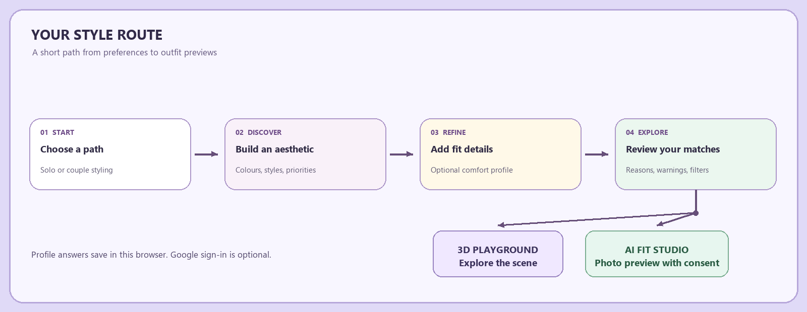
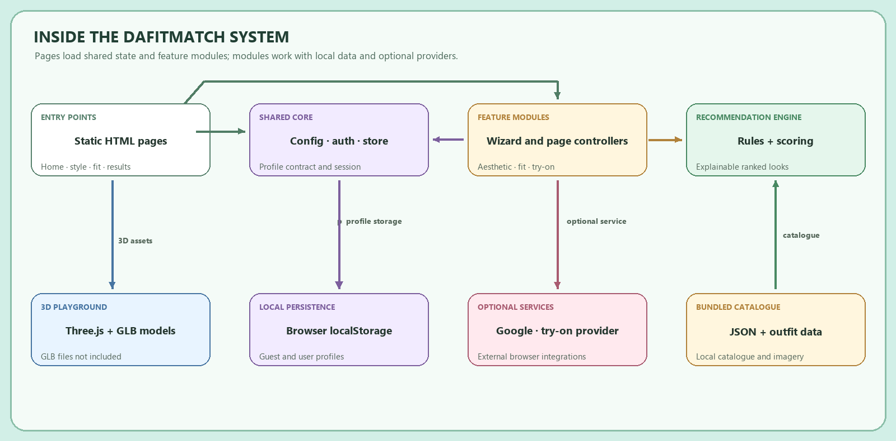
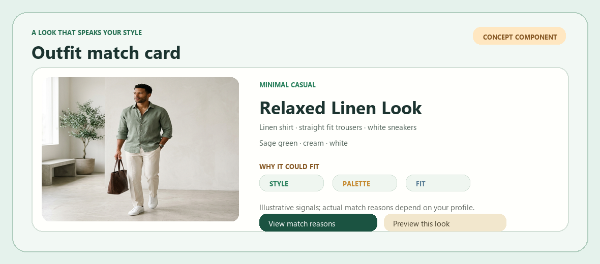

<div align="center">

# DaFitMatch

### Personal style, made practical.

Build a style profile, explore outfit matches with clear reasons, and preview looks in a browser-based styling studio.


**Discover → Refine → Match → Preview**

</div>


---

<div align="center">

**[Product](#the-dafitmatch-brief)　·　[Experience](#inside-the-experience)　·　[Features](#tools-in-the-atelier)　·　[Architecture](#how-the-pieces-connect)　·　[Setup](#set-up-your-workspace)**

</div>

<details>
<summary><strong>Full table of contents</strong></summary>

- [The DaFitMatch brief](#the-dafitmatch-brief)
- [The idea](#the-idea)
- [Inside the experience](#inside-the-experience)
- [Tools in the atelier](#tools-in-the-atelier)
- [Materials and technology](#materials-and-technology)
- [How the pieces connect](#how-the-pieces-connect)
- [Repository map](#repository-map)
- [Set up your workspace](#set-up-your-workspace)
- [Local settings](#local-settings)
- [Data and connected services](#data-and-connected-services)
- [Privacy notes](#privacy-notes)
- [Developer notes](#developer-notes)
- [Contributing](#contributing)
- [Project details](#project-details)
- [Outfit match card concept](#outfit-match-card-concept)

</details>

## The DaFitMatch brief

- **🎨 Personal style** — Shape a profile through aesthetics, colours, priorities, and exclusions.

- **🧵 Fit and comfort** — Add practical preferences for silhouettes, movement, comfort, and wardrobe habits.

- **✨ Explainable matches** — Explore ranked catalogue looks with match reasons, score details, and useful warnings.

- **🪞 Look previews** — Try the Three.js styling playground or explore the clearly labelled Fit Studio preview.

- **Purpose:** Explore personal style preferences and rank a bundled outfit catalogue.
- **For:** Individuals exploring outfits; couple styling context is also represented in the site.
- **Runtime:** Static HTML, CSS, and JavaScript in the browser. No backend or build pipeline is present.
- **Status:** The repository contains a static site and demo flows. Release/deployment status is unspecified.

<br>

## The idea

- **Personal discovery:** Users describe what they like, what they avoid, and how they want clothes to fit.
- **Clear recommendations:** Catalogue looks include reasons that explain how profile preferences informed their ranking.
- **Project interpretation:** This describes the implemented flows, not a separate published product statement.

<br>

## Inside the experience

- **Discover:** Explore the landing page and complete an eight-step aesthetic profile.
- **Refine:** Optionally add fit, comfort, occasion, and solo/couple preferences.
- **Match:** Browse catalogue looks ranked against the saved profile, with score details, warnings, and exclusion explanations.
- **Preview:** Explore the 3D playground or AI Fit Studio, with unavailable services clearly presented as demos.
- **Save:** Profiles stay in browser `localStorage`, either as a guest profile or under a Google subject when sign-in is configured.
- **Catalogue:** Outfit data is bundled as local JSON. The project has no server-side account system or database.

<br>

### Pages & interactions

- [`index.html`](index.html) — Landing page with solo/couple journey entry points, “How it works” and couple sections, catalogue drawer, and 3D playground. The playground supports scene controls, catalogue selection, and image/video try-on overlays where matching assets exist. Responsive layout and reduced-motion styles are present.

- [`aesthetic.html`](aesthetic.html) — Eight-step style discovery flow covering aesthetics, colours, fit, formality, styling priorities, exclusions, footwear, and refinements. Answers autosave; users can review, navigate, complete, or reset the profile.

- [`fit-profile.html`](fit-profile.html) — Optional practical fit profile covering garment fit, silhouettes, sizes, comfort, mobility, fabrics, layering, accessories, wardrobe strategy, notes, and optional photo preview. Couple mode keeps each person's fit profile separate.

- [`recommendations.html`](recommendations.html) — Ranks the catalogue using saved aesthetic and fit preferences. Users can filter by gender, category, budget, and (in couple mode) person. Cards show reasons, warnings, and score breakdowns; an empty-result state suggests widening filters or updating preferences.

- [`ai-fit-studio.html`](ai-fit-studio.html) — Select a catalogue outfit, choose a JPEG/PNG/WebP photo up to the configured size limit, consent, and generate a preview. Uses a configured endpoint or Hugging Face IDM-VTON when available; otherwise displays a clearly labelled local composite.

- Most pages use responsive Tailwind utility classes loaded from a CDN.
- `index.html` includes custom responsive and reduced-motion rules.
- Pages that fetch the catalogue require a local HTTP server; opening via `file://` is not supported for those flows.
- Network access is needed for CDN-hosted libraries, fonts, Google Identity Services, or remote try-on services.

<br>

### Your style journey



- The aesthetic and fit forms allow users to continue through optional sections.
- An empty profile still produces general catalogue highlights rather than personalized matches.
- Couple mode is represented in state, partner fit controls, and recommendation filtering.
- The repository does not document a shared online session or invite flow.

<br>

## Tools in the atelier

- **Style discovery:** An eight-step wizard stores aesthetic preferences in a structured profile.
- **Fit and comfort profile:** Captures fit, silhouette, size information, movement and comfort needs, and wardrobe preferences. Size fields are informational in the store contract; recommendation scoring uses supported fit signals rather than treating sizes as measurements.
- **Explainable recommendations:** A deterministic, weighted rules engine ranks catalogue outfits, exposes reasons and criterion breakdowns, applies hard exclusions, and marks conflicts with warnings.
- **Catalogue browsing:** Outfit cards and the homepage drawer use the bundled JSON dataset, including price, categories, style, colours, items, and linked image/model paths.
- **3D fitting-room playground:** Three.js and `GLTFLoader` attempt to load a base character and outfit models. The expected GLB paths are documented in [`assets/models/README.md`](assets/models/README.md); the required model files are not present in this repository, so 3D character/outfit rendering depends on adding those assets. The page includes other scene and try-on presentation controls.
- **AI Fit Studio:** Supports a configured HTTP(S) multipart endpoint or Hugging Face IDM-VTON integration. If no provider is available or a call fails, the app labels a locally composed preview as a demo rather than presenting it as AI output.
- **Guest and Google sign-in state:** Google Identity Services integration is optional. Without a configured client ID the app remains usable as a guest.

<br>

## Materials and technology

<div align="center">


</div>

### Technology overview

- **HTML, CSS, and JavaScript** — Multi-page browser app and classic script modules; no framework or bundler.
- **Tailwind CSS CDN** — Utility styling loaded by the pages.
- **Three.js `0.160.0` + `GLTFLoader`** — 3D scene and optional glTF character/outfit rendering. GLB files are not included in this checkout.
- **`localStorage`** — Guest and signed-in profile persistence in the browser.
- **Google Identity Services** — Optional client-side Google sign-in.
- **Hugging Face Spaces / Gradio client** — Optional remote IDM-VTON integration for AI Fit Studio.
- **JSON** — Bundled outfit catalogue in `src/data/catalogue.json`.

<br>

## How the pieces connect



- Pages load classic scripts directly; each HTML file declares their order.
- `src/core/store.js` provides the shared profile contract and per-user local persistence.
- The aesthetic and fit controllers write profile data to that store.
- The recommendation UI fetches the JSON catalogue and passes it with profile data to the pure scoring engine.
- No application API server, database, server-side authentication, or backend storage is implemented.

<br>

## Image notes

- The animated satin-ribbon hero above is a README illustration.
- The repository also contains editorial hero artwork and catalogue images; these are project assets, not screenshots of the live interface.
- README motion is limited to the embedded GIF. GitHub and VS Code do not run custom README CSS or JavaScript.

## Repository map

```text
.
├── index.html                         # Landing page, catalogue drawer, 3D playground
├── aesthetic.html                     # Eight-step style profile
├── fit-profile.html                   # Fit, comfort, and practical profile
├── recommendations.html              # Ranked catalogue and filters
├── ai-fit-studio.html                 # Photo-based try-on UI and fallback
├── docs/ARCHITECTURE.md               # Profile and recommendation architecture
├── src/
│   ├── config.example.js              # Runtime configuration template
│   ├── core/auth.js                   # Optional Google sign-in/session
│   ├── core/store.js                  # Shared local profile store
│   ├── data/catalogue.json            # Bundled outfit data
│   └── features/
│       ├── aesthetic/                 # Style wizard controller
│       ├── fit/                       # Fit profile controller
│       ├── recommendations/           # Rules, engine, and page UI
│       ├── tryon/                     # AI Fit Studio controller
│       └── viewer/                    # Three.js fitting-room viewer
├── assets/
│   ├── brand/
│   │   ├── dafitmatch-animated-hero.gif       # Animated README hero
│   │   ├── user-journey-flow.png              # High-contrast flow diagram
│   │   ├── system-architecture-flow.png       # High-contrast architecture diagram
│   │   └── recommendation-card-concept.png    # Focused outfit card concept
│   ├── images/catalogue/              # Outfit images and SVG fallbacks
│   ├── images/try-on/                 # Try-on reference imagery
│   └── models/README.md               # Expected GLB asset requirements
└── tools/archive/                     # Archived experiments and dev scripts
```

## Set up your workspace

- Use a modern browser and Python 3 (or another static HTTP server).
- The repository does not specify a minimum browser version or require Node.js.

- Clone the repository and change into its directory.
- Start a static server from the repository root:

   ```powershell
   python -m http.server 8000
   ```

- Open [http://localhost:8000/index.html](http://localhost:8000/index.html).

- The catalogue is fetched over HTTP, so do not open the HTML files directly with `file://`.

## Local settings

- Configuration is optional for guest browsing and local recommendations.
- To create local settings, copy the template:

```powershell
Copy-Item src/config.example.js src/config.js
```

- `src/config.js` is ignored by Git.
- The example file contains placeholder values, not usable credentials.

- `GOOGLE_CLIENT_ID` — Optional Google Identity Services web client ID. Add the local/deployed origin to that OAuth client's authorised JavaScript origins; needed only for Google sign-in.
- `APP_NAME` — Optional application name; the template defaults to `DaFitMatch`.
- `STORAGE_NAMESPACE` — Optional key for stored profile maps in browser localStorage; the template provides a default.
- `DEMO_MODE` — Optional template flag for explicit demo behavior when external services are unavailable.
- `TRY_ON_PROVIDER` — Optional selector for the Hugging Face path when set to `huggingface` and no custom endpoint is selected.
- `TRY_ON_HF_TOKEN` — Optional Hugging Face access token for the IDM-VTON Space. Treat it as a secret.
- `TRY_ON_HF_SPACE` — Optional Hugging Face Space identifier; the template uses `yisol/IDM-VTON`.
- `TRY_ON_ENDPOINT` — Optional custom HTTP(S) endpoint accepting multipart fields `image`, `outfit_id`, and `prompt`, and returning an image or JSON with an `image` URL. Takes precedence over Hugging Face.
- `TRY_ON_MAX_BYTES` — Optional maximum upload size in bytes; defaults to 5 MiB.

## Data and connected services

- **Catalogue source:** `src/data/catalogue.json` is bundled with the project. Update it and check that referenced assets exist.
- **No backend database:** There is no database, migration system, seed command, or project-owned API server.
- **Custom try-on service:** When configured, the browser sends `image`, `outfit_id`, and `prompt` in a multipart `POST`. The response can be an image or JSON containing an image URL.
- **Hugging Face integration:** When `TRY_ON_PROVIDER` is set to `huggingface`, the controller calls the configured Space through `@gradio/client`.
- **Network boundary:** These are outbound integrations. The application implements no other HTTP endpoints.

<br>

## Privacy notes

- Profile answers are stored in the current browser's localStorage. The application has no backend profile store.
- The optional photo on the fit-profile page is previewed locally; its image bytes are not persisted by the profile store. The store records photo metadata and a consent flag.
- AI Fit Studio requires explicit consent before generation. Its selected photo stays in tab memory for the local preview path; when a provider is configured, the photo is sent to that service. Review that provider's terms and privacy practices before use.
- Google sign-in is client-side integration. The source stores a decoded session profile and expiration in localStorage; no server-side token verification is implemented in this repository. It should not be treated as a production authentication boundary.
- Do not commit `src/config.js` or real access tokens. The repository's `.gitignore` excludes `config.js` and `.env*` files.

## Developer notes

- No active test runner, lint command, or quality-check script is defined in the project configuration.
- Archived scripts under `tools/archive/` are not presented as supported checks.

### Troubleshooting

- **Catalogue is unavailable or a page reports a fetch error:** Start the HTTP server at the repository root and reload; `file://` cannot serve the JSON fetch.
- **Google sign-in says it is not configured:** Create `src/config.js` from the example, set `GOOGLE_CLIENT_ID`, and authorise the exact serving origin in Google Cloud. Guest mode remains available.
- **AI Fit Studio shows a local demo:** No provider is configured, or remote inference failed. The demo composite is labelled and is not an AI try-on. Check endpoint/token settings and network access.
- **3D character or outfit does not appear:** The GLB files are absent from this checkout. See [`assets/models/README.md`](assets/models/README.md) for expected paths and model requirements.
- **External styling or fonts are missing:** The pages load Tailwind and fonts from external CDNs; check network access.

## Contributing

- No contribution guide or code-style configuration is specified.
- Keep the static, classic-script loading model in mind: pages load shared scripts and relative assets directly.
- Update [`docs/ARCHITECTURE.md`](docs/ARCHITECTURE.md) and this README when profile contracts, scoring behavior, configuration, or page flows change.
- Do not commit real credentials or user photos.

<br>

## Project details

- No license, maintainer contact, or acknowledgement details are specified in the repository.

### Details not verified in the repository

- Production deployment host, public website URL, and release status.
- Formal product vision beyond the interpretation stated above.
- Licensing and source/ownership of catalogue and brand images.
- Whether a deployed Google OAuth client or Hugging Face token is available.
- The GLB character and outfit models expected by the viewer are not included in this checkout.
- Formal support policy, contribution workflow, and maintainer contact.

<br>

---

<div align="right"><sub>DaFitMatch · A style exploration project</sub></div>

## Outfit match card concept

The visual below explores a focused recommendation component using real catalogue imagery and outfit details. It is a **concept mockup**, not a screenshot of the implemented page. It shows a single outfit card rather than a full-page interface, so it complements the animated brand hero with a different product interaction.



---

<div align="center">

# DaFitMatch

### Personal style, made practical.

Build a style profile, explore outfit matches with clear reasons, and preview looks in a browser-based styling studio.


**Discover → Refine → Match → Preview**

</div>
